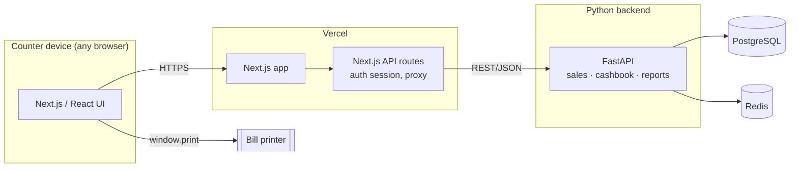

# Chathura Printers — Cash Register Web App
**Project plan & architecture spec**

A simple, web-based cash register for **Chathura Printers** — take a sale, print the bill, and keep the cashbook and profit numbers accurate automatically. Built with Next.js (React), a Python backend, PostgreSQL, and Redis, on free/open-source hosting.

---

## 1. What "Cash Register for Windows" does (the reference app)

This is the free Windows desktop tool you linked. Its feature set is small and old-school, but it's a good baseline:

- Calculates transaction totals like a physical till
- Barcode-scanner input for products
- Custom tax rate per country/state
- Basic product inventory tracking
- Sales reports by day / month / year
- Charts of inventory and profit by month/year
- Deliberately simple, "no accounting background needed" UI

**What we're changing:** it's a single-PC Windows `.exe`. Our version is a web app — it runs on any laptop, tablet, or even a phone at the counter, works from any browser, and prints straight to whatever printer is connected to that device. Same simplicity, no installer.

---

## 2. Goals for this build

1. Ring up a sale and **print a bill** in a few taps — this is the priority.
2. Every sale and expense **automatically books itself into a cashbook** — no manual double-entry.
3. Always-visible **profit and cash-position numbers**, not just a pile of transactions.
4. **Zero or near-zero hosting cost**, using only open-source/free-tier services.
5. Simple enough that anyone minding the counter can use it with no training.

---

## 3. Feature scope

| MVP (build first) | Phase 2 (add later) |
|---|---|
| Item/service list with prices (printing, photocopying, lamination, binding, stationery, custom line) | Barcode/quick-code lookup |
| Register screen: add items → running total → print | Multiple cashier logins with roles (admin/cashier) |
| Print bill (browser print, thermal or A4) | Customer accounts / running credit tabs |
| Cashbook: every sale & expense auto-logged | Low-stock alerts for stationery items |
| Manual expense entry (ink, paper, electricity, rent...) | CSV/Excel export of reports |
| Daily cash balance view | Direct thermal-printer agent (skip the print dialog) |
| Profit report (day/month): revenue − expenses | Charts (inventory/profit trends) |
| Simple owner's-equity tracking | Automated backups, audit log |

---

## 4. Tech stack

| Layer | Technology | Why |
|---|---|---|
| Frontend | **Next.js (React)**, deployed on **Vercel** | As you specified — fast, SSR, great DX |
| Backend — business logic | **Python (FastAPI)** | Owns all the money math: sales, cashbook, profit, reports |
| Backend — thin layer | **Next.js API routes** | Auth session handling, and a light proxy to FastAPI so the browser only ever talks to one origin |
| Database | **PostgreSQL** | Sales, items, cashbook, expenses, equity — all relational, needs real transactions |
| Cache / fast state | **Redis** | Caches today's running cash balance, holds short-lived sessions, and gives you an atomic counter for bill numbers so two devices never double-issue a bill number |

**Why split Next.js and Python like this:** Next.js is great at UI and at being the single public entry point, but you don't want financial logic (totals, tax, cashbook postings, profit calculation) duplicated in two languages. Keep that in one place — FastAPI — and let Next.js call it. Next.js's own API routes just handle login sessions and forward everything else.

---

## 5. Architecture



---

## 6. Database schema (PostgreSQL)

```sql
CREATE TABLE users (
  id SERIAL PRIMARY KEY,
  name TEXT NOT NULL,
  email TEXT UNIQUE NOT NULL,
  password_hash TEXT NOT NULL,
  role TEXT NOT NULL DEFAULT 'cashier',   -- 'admin' | 'cashier'
  created_at TIMESTAMPTZ DEFAULT now()
);

CREATE TABLE items (
  id SERIAL PRIMARY KEY,
  name TEXT NOT NULL,                     -- 'A4 B/W Print', 'Lamination A4', 'Spiral Binding'
  category TEXT NOT NULL,                 -- 'printing' | 'photocopy' | 'lamination' | 'binding' | 'stationery' | 'other'
  unit TEXT NOT NULL DEFAULT 'each',      -- 'page' | 'copy' | 'sheet' | 'each'
  unit_price NUMERIC(12,2) NOT NULL,
  barcode TEXT,
  is_active BOOLEAN DEFAULT true
);

CREATE TABLE sales (
  id SERIAL PRIMARY KEY,
  bill_number TEXT UNIQUE NOT NULL,
  cashier_id INTEGER REFERENCES users(id),
  subtotal NUMERIC(12,2) NOT NULL,
  discount NUMERIC(12,2) NOT NULL DEFAULT 0,
  tax_amount NUMERIC(12,2) NOT NULL DEFAULT 0,
  total NUMERIC(12,2) NOT NULL,
  payment_method TEXT NOT NULL DEFAULT 'cash',  -- 'cash' | 'card' | 'bank'
  created_at TIMESTAMPTZ DEFAULT now()
);

CREATE TABLE sale_items (
  id SERIAL PRIMARY KEY,
  sale_id INTEGER REFERENCES sales(id) ON DELETE CASCADE,
  item_id INTEGER REFERENCES items(id),
  description TEXT NOT NULL,
  quantity NUMERIC(10,2) NOT NULL,
  unit_price NUMERIC(12,2) NOT NULL,
  line_total NUMERIC(12,2) NOT NULL
);

CREATE TABLE expenses (
  id SERIAL PRIMARY KEY,
  expense_date DATE NOT NULL DEFAULT CURRENT_DATE,
  category TEXT NOT NULL,                 -- 'ink' | 'paper' | 'electricity' | 'rent' | 'maintenance' | 'other'
  amount NUMERIC(12,2) NOT NULL,
  description TEXT,
  created_by INTEGER REFERENCES users(id),
  created_at TIMESTAMPTZ DEFAULT now()
);

CREATE TABLE cashbook_entries (
  id SERIAL PRIMARY KEY,
  entry_date DATE NOT NULL DEFAULT CURRENT_DATE,
  entry_type TEXT NOT NULL,               -- 'cash_in' | 'cash_out'
  category TEXT NOT NULL,                 -- 'sale' | 'expense' | 'owner_deposit' | 'owner_withdrawal'
  reference_table TEXT,                   -- 'sales' | 'expenses' | NULL
  reference_id INTEGER,
  amount NUMERIC(12,2) NOT NULL,
  running_balance NUMERIC(12,2) NOT NULL,
  note TEXT,
  created_at TIMESTAMPTZ DEFAULT now()
);

CREATE TABLE equity_ledger (
  id SERIAL PRIMARY KEY,
  entry_date DATE NOT NULL DEFAULT CURRENT_DATE,
  entry_type TEXT NOT NULL,               -- 'opening_capital' | 'profit_retained' | 'owner_drawing'
  amount NUMERIC(12,2) NOT NULL,
  note TEXT
);
```

Every `POST /sales` and `POST /expenses` call should write its rows **and** the matching `cashbook_entries` row inside one database transaction — that's what keeps the cashbook trustworthy.

---

## 7. Cashbook, equity & profit — how the numbers actually work

Quick correction on the formula, folded into something directly usable: the standard identity is **Assets = Liabilities + Equity**, not "Assets = Equity + Expenses." For a small cash business like this with no loans or supplier credit, Liabilities is roughly zero, so in practice:

> **Assets (cash + inventory + equipment) ≈ Equity**

And Equity moves like this, day to day:

> **Equity(today) = Equity(yesterday) + Net Profit − Owner Withdrawals + Owner Deposits**

Where profit for any period is simply:

> **Net Profit = Total Sales Revenue − Total Expenses**

So in the schema above, three things should always reconcile at day's end:
1. **`cashbook_entries`** running balance — the physical cash position
2. **`sales` − `expenses`** for the period — what produced that cash
3. **`equity_ledger`** balance — what the owner's stake is worth

A "close the day" screen that checks these three against each other is effectively your built-in audit — if they don't match, something wasn't recorded through the app (e.g. cash taken out by hand).

---

## 8. API sketch (FastAPI)

| Endpoint | Purpose |
|---|---|
| `POST /auth/login`, `GET /auth/me` | Login / session |
| `GET /items`, `POST /items`, `PATCH /items/:id` | Manage the price list |
| `POST /sales` | Create a bill: line items + payment method → writes `sales`, `sale_items`, `cashbook_entries` in one transaction, returns printable bill data |
| `GET /sales?date=` | List/search past bills |
| `POST /expenses`, `GET /expenses?range=` | Record and list expenses |
| `GET /cashbook?range=` | Ledger + running balance |
| `GET /reports/daily?date=`, `/reports/monthly?month=` | Revenue, expenses, profit, equity snapshot |

---

## 9. Printing the bill

**MVP approach — browser printing, no extra infrastructure:**
Render the bill as an HTML view styled for receipt width (58mm/80mm) or A4 with a print-specific stylesheet, then trigger `window.print()`. This works with *any* printer already set up on the counter's PC or laptop — including most USB thermal receipt printers, since Windows exposes them as ordinary printers.

**Phase 2 — skip the print dialog:**
Run a small local "print agent" (a tiny Python or Node service listening on `localhost` on the counter PC) that receives raw ESC/POS commands from the web app and sends them straight to the thermal printer. Only worth building once the browser-print flow feels slow in practice.

---

## 10. UI guidelines — keep it fast and obvious

The whole point of a till is speed, so:

- **Category tabs** across the top: Printing / Photocopy / Lamination / Binding / Stationery / Custom
- **Large, tappable item buttons** in a grid below — big enough to hit accurately on a cheap tablet
- **Running bill panel** on the side, like a receipt tape: line items + live total
- **Numeric keypad** for entering page counts or a custom price, not a tiny text input
- One big, high-contrast **"Print & Complete"** button, with a simple Cash/Card toggle before it
- A separate, calmer **"Day Summary"** screen (not part of the fast counter flow) for cash balance, expenses, and profit
- Minimal color palette, large text, no dense tables on the register screen itself — save tables for the reports screen

Design it to work on whatever's actually sitting at the counter — an old laptop, a budget Android tablet, anything with a browser.

---

## 11. Hosting plan — free & open source

You asked for Vercel on the frontend, so that's kept fixed. One important thing to flag first:

> **Heads-up on Vercel's free tier:** Vercel's Hobby plan is free but its own terms restrict it to *non-commercial, personal* use — a real business site technically needs the paid Pro plan ($20/month). This isn't legal advice, just what Vercel's terms currently say — worth a read yourself before relying on it for the shop. If you'd rather stay fully free and avoid the question entirely, **Cloudflare Pages** hosts Next.js for free with no such commercial-use restriction and is a drop-in alternative.

Two ways to host everything else, both $0:

### Path A — fastest to set up (separate managed free tiers)

| Piece | Service | Free tier reality |
|---|---|---|
| Frontend | **Vercel** (as requested) | 100GB bandwidth/month, generous limits — see caveat above |
| Backend (FastAPI) | **Render** | Free web service, sleeps after 15 min idle, ~30–60s cold start on the next request. Fine for a shop that opens once a day and stays busy after that |
| Postgres | **Neon** | Permanent free tier: ~0.5GB storage, 100 compute-hours/month, scales to zero when idle (no data loss), no card required |
| Redis | **Upstash** | Permanent free tier: 256MB, 500,000 commands/month, no card required |

Everything auto-deploys from GitHub, zero servers to maintain, and the only cost of "free" is that first request of the day being a bit slow while Render wakes up.

### Path B — one box, no cold starts (self-hosted backend)

| Piece | Service | Notes |
|---|---|---|
| Frontend | **Vercel** (or Cloudflare Pages) | Same as above |
| Backend + Postgres + Redis, all together | **Oracle Cloud "Always Free" ARM VM**, via Docker Compose | Runs FastAPI, Postgres, and Redis on one always-on server, no sleep, no monthly hour cap. Oracle's free ARM allocation was cut back in 2026 (from 4 OCPU/24GB RAM down to roughly 2 OCPU/12GB RAM) but that's still comfortably enough for this app. You maintain OS updates, backups, and HTTPS (Caddy or nginx + Let's Encrypt) yourself. A card is required at signup for identity verification only — it isn't charged on the free tier. |

**Recommendation:** start with **Path A** — it's the fastest to get the register actually working. Move to **Path B** later only if the Render cold start becomes annoying, or if you outgrow the free database limits.

Free-tier terms change often — before committing, check the current numbers directly: `vercel.com/docs/limits`, `render.com/pricing`, `neon.com/pricing`, `upstash.com/pricing`, and Oracle's Always Free page.

---

## 12. Environment variables checklist

**Frontend (Vercel):**
```
NEXT_PUBLIC_API_URL=
NEXTAUTH_SECRET=
NEXTAUTH_URL=
```

**Backend (Render / Oracle VM):**
```
DATABASE_URL=
REDIS_URL=
JWT_SECRET=
ALLOWED_ORIGINS=          # your Vercel domain
APP_TIMEZONE=Asia/Colombo
DEFAULT_CURRENCY=LKR
```

---

## 13. Build roadmap

- **Phase 0 — Setup:** scaffold the Next.js app and the FastAPI service in one repo (or two), provision Neon + Upstash, deploy empty skeletons to Vercel + Render so the pipeline works end to end.
- **Phase 1 — Core register (MVP):** item/price management, the register screen itself, browser bill printing, cashbook auto-posting on every sale, manual expense entry, a live cash-balance view.
- **Phase 2 — Reports & profit:** daily/monthly revenue vs. expenses, the profit figure, the equity roll-forward, simple charts.
- **Phase 3 — Nice-to-haves:** barcode/quick-code item lookup, multiple cashier accounts with roles, customer credit tabs, low-stock alerts, the local thermal-printer agent, automated backups.

---

## 14. Next steps

1. Confirm the item/price list for Chathura Printers (printing, photocopy, lamination, binding, stationery — with actual prices) so `items` can be seeded.
2. Decide Path A vs. Path B for hosting.
3. Scaffold the two repos and get "hello world" deployed on both Vercel and the chosen backend host before writing any register logic.
